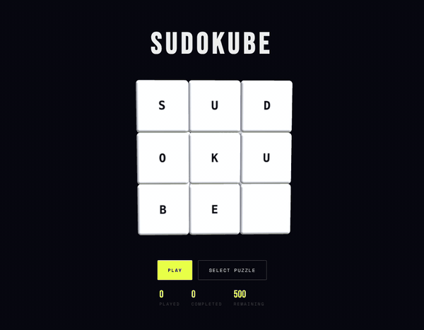
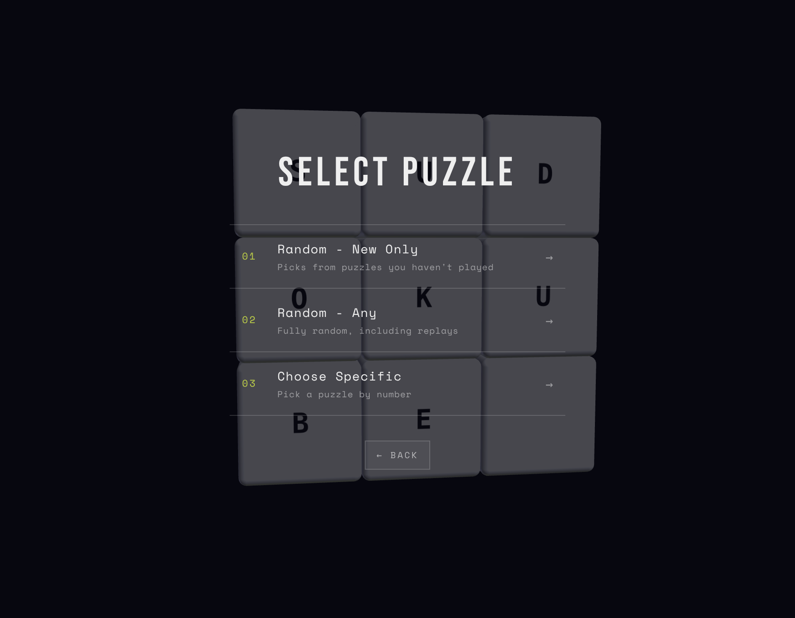
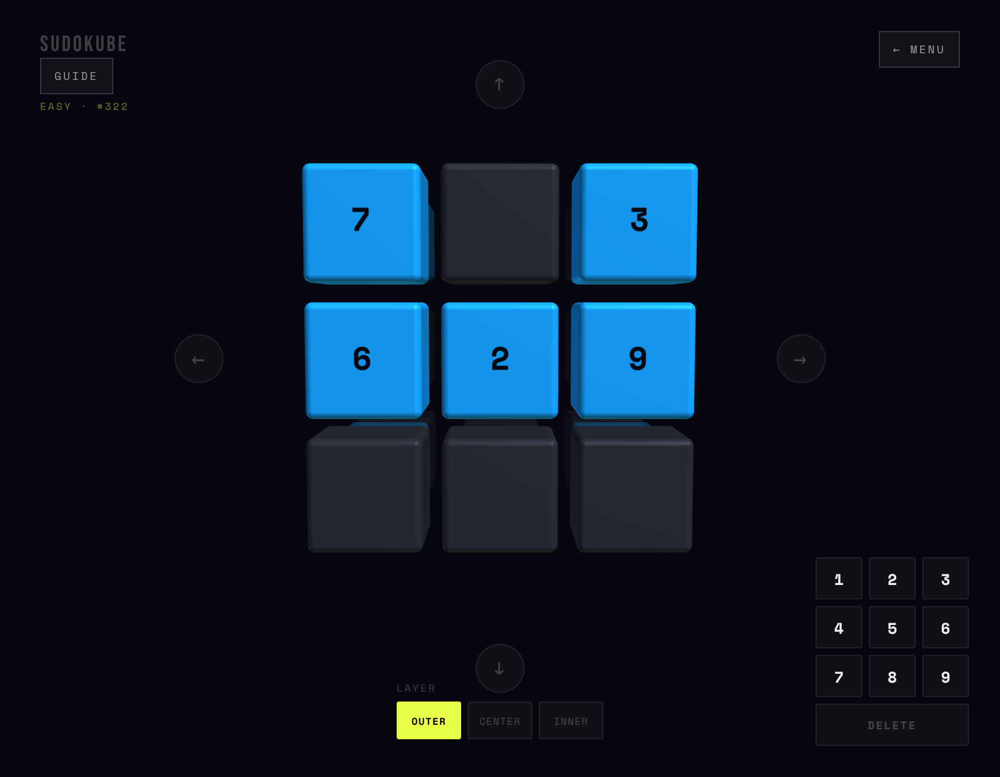

# Sudokube

Sudokube is a browser-based 3D Sudoku puzzle game. It runs entirely in the browser as a static site. The idea is a sudoku board with a z axis making a 3x3x3 cube similar to a Rubik's cube and has 1 through 9 appearing 1 time on each unique axis and having no overlap between them. Its human solvable and harder then you'd think. 

# Why Play
Its a fun brain game meant to give you something to do to keep your brain stimulated in a way things like chess and normal sudoku do. A good way too track your left brain thinking for yourself as well.The Three.js runtime files used by the game are bundled locally in `vendor/` so the published site does not depend on CDN-hosted game scripts.

## How it works
- **Puzzle data:** `easy-puzzles.js` holds 500 pre-generated puzzles. Each has an `id`, a `seed` (0xDEADBEEF + id, so puzzle N is always the same), a clue count, the grid `p[x][y][z]` (0 = empty) and the answer key `s[x][y][z]`.
- **Loading puzzles:** `puzzle-loader.js` stores puzzles in a Map keyed by puzzle number. `getClone()` returns a safe copy, `getSolution()` returns the answer key, and `getRandom()`, `getNext()` and `getPrev()` handle navigation.
- **Choosing a puzzle:** Play picks one you haven't played, Random Any picks from all 500, and Choose Specific loads one by number.
- **Rules:** every cell sits in three 3x3 planes (same x, y or z), and each plane must contain 1 to 9 exactly once.
- **Checking answers:** entries that repeat a number in a plane are flagged and shake. A plane is solved when it matches the answer key, and the puzzle is complete when every plane matches.
- **Rendering:** Three.js (bundled in `vendor/`) draws the 27 cells and animates the title spin, the explode and reassemble effect, and layer switching.
- **Saving progress:** `storage.js` saves history to `localStorage` (`sudokube_history`) behind one interface, so it can be swapped for the planned backend API.
- **Tests:** `node test.js` checks the validation, generator and solver in `sudoku3d.js`.

## Project Status

- The game is playable now (500 puzzles, local progress saving).
- Sprint 1 (MVP), in progress: Docker container, Google Cloud Run deployment, and CI with GitHub Actions running `node test.js`.
- Sprint 2 (Final): hints and user accounts.

## Tech Stack

<table>
<tr>
<td width="25%" valign="top"><strong>Current Tech Stack</strong></td>
<td width="75%">
Front End- JS, HTML/CSS and Three.js for cubes<br> 
  Back End- None (Static)<br>
  Database- Local Storage<br>
  Testing- node test.js<br>
  Deployment- Github Pages<br>
  AI- Used for Animations and Copilot in VScode for manual coding in line suggestions and debugging (Typos)
</td>
</tr>
</table>

<table>
<tr>
<td width="25%" valign="top"><strong>Planned Tech Stack</strong></td>
<td width="75%">
Front End- JS, HTML/CSS and Three.js for cubes<br> 
  Back End- Node.js and Express API<br>
  Database- PostgreSQL<br>
  Testing- node test.js<br>
  Deployment- Docker + GitHub Actions + Google Cloud<br>
  AI- Continued Use for animations and chatbot assistance for major edge case bugs I cant find any help with (Claude, Codex)
</td>
</tr>
</table>


## Live Demo Links

Link (Static Github Pages)- https://ronan-chr.github.io/Sudokube/

Deployed URL (Cloud Run): https://sudokube-580113394078.us-central1.run.app/

Jira board (Sprints): https://ronan2249.atlassian.net/jira/software/projects/SUD/boards/37 

Confluence: https://ronan2249.atlassian.net/wiki/spaces/SUD/overview

## Play Locally

Because the app uses JavaScript modules, run it from a small local server:

```bash
python -m http.server 4173
```

Then open:

```text
http://127.0.0.1:4173/index.html
```

## Run With Docker

The app is on a static server by using `nginx:alpine` on port 8080.

```bash
docker build -t sudokube .
docker run -p 8080:8080 sudokube
```

Then open:

```text
http://localhost:8080
```

## Run With Docker Compose

```bash
docker compose up --build
```

Then open:

```text
http://localhost:8081
```

Stop it with:

```bash
docker compose down
```

## Deploy to Cloud Run

From the project folder, with the Google Cloud CLI installed and logged in:

```bash
gcloud run deploy --source .
```

Pick a region and allow unauthenticated access when asked. The command prints the service URL when it finishes.

## Publish With GitHub Pages

1. Create a new GitHub repository.
2. Upload the contents of this folder, not the folder itself.
3. In GitHub, open `Settings` -> `Pages`.
4. Set the source to your main branch and root folder.
5. Save, then open the GitHub Pages URL after it finishes deploying.

## Privacy

No account, server, analytics, or personal data collection is used. Puzzle progress is stored locally in the player's browser.

## Development Check

Run the puzzle logic tests with:

```bash
node test.js
```
## Git Workflow

- `main` always holds working code.
- New work goes on a feature branch (for example `feature/dockerfile`).
- Each branch is merged into `main` through a pull request after `node test.js` passes.

## Screens

### Home Screen

Spinning Cube with a play button which brings you to the select screen.


### Select Puzzle Screen

Theres a random puzzle of ones you havent played one that lets you play ones youve already completed or played and then choose specific which has a slider for 1-500 puzzles.


### Play Screen

Theres a cube you can click cells and enter a number either through your keyboard or clicked and then using the small entry calculator bottom right with 1-9 availible. There is also a cheat sheet key top left of the screen.


## Feedback to be acted on
- Golf Mode (Perspective changes deduct points higher the better)
- Calculator shading out when a number is verifiably correct 3 times across a puzzle
- A way to have note taking on perspectives or cells (potentially labels as dots)
- Accounts for users
- A daily cube puzzle (The same for all user timed and no hints or cheat sheet with a leaderboard for comparison)
- A performance page with puzzles completed with hints average times and any other comprehenssive stats
- A better experience for mobile

## Sprint Progression (Sprint 1)
 Current status: 

- [x]
SUD4- As a player, I want a wrong number to be replaced cleanly when I enter the right one, so that the cube never shows a false state.Description Acceptance criteria: Entering multiple wrong numbers and then the right one shows only the right number as solved cell. Colors go to the wrong answer as green for some reason in this specific condtion so that not happening

- [x]
SUD30- As the developer, I want the app in Docker and deployed to Google Cloud, so that it runs the same everywhere. Description Acceptance criteria: The app builds and runs from a Docker image. A live URL serves the app from Cloud Run

- [ ]
SUD34- As the developer, I want GitHub Actions to test and deploy on every push, so that bugs are caught early. Description Acceptance criteria: A push to main runs the tests. If the tests pass, the app deploys automatically. Automate the bug catching process

- [x] (Done besides the Actual Deployed Links)
SUD38- Update the README for the MVP Description Acceptance criteria: Add current status, setup steps (local, Docker, Cloud Run), the Cloud Run URL, and a section on AI tools used. Do it on a feature branch and merge with a PR.

## AI Tool Usage

Rule I use is to never believe AI or trust it for anything it makes assumptions that end up breaking things later I only like asking for advice if Im getting an error I dont understand or if its a copilot suggestion I was already going to do and my autocomplete doesnt go further then the line Im on to protect it from haiving code I dont want or features I dont want. (Also never let AI access a repo I only like to paste errors from the terminal and ask why is this happening If I cant fix it)

<table>
<tr>
<td width="25%" valign="top"><strong>Docker Debugging (Claude)</strong></td>
<td width="75%">
  <code>docker build</code> failed with "failed to connect to the docker API".<br>
  Claude helped me figure out the Docker Desktop engine wasn't running.<br>
  After starting it, port 8080 was already in use on my PC, so I ran the container with <code>-p 8081:8080</code>.<br>
  I tested it at localhost:8081 and confirmed the game loaded.
</td>
</tr>
<tr>
<td width="25%" valign="top"><strong>Branch / Version Mismatch (Claude)</strong></td>
<td width="75%">
  My README changes wouldn't push because GitHub's <code>main</code> had a newer commit than my local copy in VS Code.<br>
  Claude helped me see it was a version mismatch and walked me through <code>git stash</code>, <code>git pull</code> and merging <code>main</code> into my branch.<br>
  I ran the commands, resolved the README merge and merged the PR.
</td>
</tr>
<tr>
<td width="25%" valign="top"><strong>Autocomplete (GitHub Copilot)</strong></td>
<td width="75%">
  I sometimes use Copilot's built-in autocomplete.<br>
  If it suggests something I don't know, like <code>.strip()</code> or <code>.length</code>, I research what it does first.<br>
  I only keep it if it's a good fit for what I'm coding.
</td>
</tr>
</table>